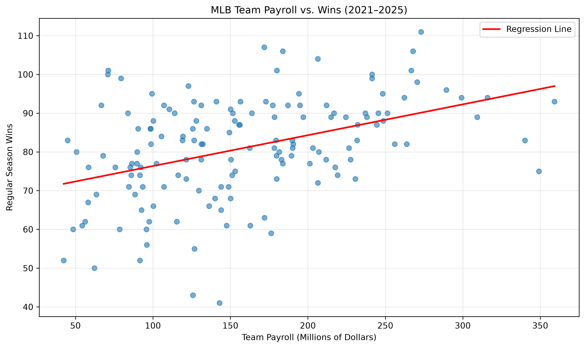
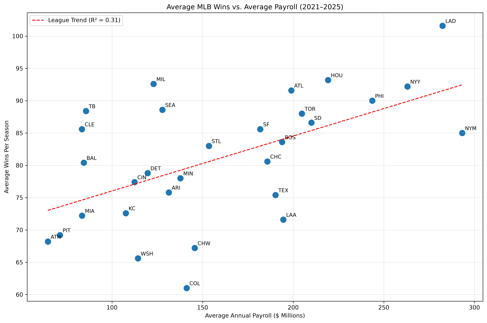

# MLB Payroll vs. Team Performance Analysis (2021–2025)

## Project Overview

Does spending more money lead to more wins in Major League Baseball?

This project investigates the relationship between MLB team payroll and regular-season success from 2021 through 2025. Using Python, pandas, SQLite, SQL, NumPy, and Matplotlib, I analyzed 150 team-season observations across all 30 MLB organizations.

The goal was to determine how strongly payroll relates to winning and identify which teams consistently outperform or underperform their payroll-based expectations.

## Technologies Used

- **Python:** Data processing, analysis, and workflow automation
- **pandas:** Data cleaning, transformation, and aggregation
- **SQLite / SQL:** Relational database creation, table joins, and cost-per-win calculations
- **NumPy:** Linear regression calculations
- **Matplotlib:** Data visualization
- **PyBaseball:** Historical MLB standings data
- **Excel:** Initial payroll data extraction and CSV preparation

## Data Sources

**MLB Team Performance:** Historical MLB standings retrieved using the Python `pybaseball` library.

**MLB Team Payroll:** Historical payroll data obtained from [Spotrac](https://www.spotrac.com/mlb/payroll/).

The dataset covers the 2021–2025 MLB seasons, with 30 teams per season and 150 total team-season observations.

Payroll data was collected from Spotrac, exported to CSV, and cleaned using pandas. Team identifiers were standardized to account for franchise name changes, including Cleveland and the Athletics.

## Methodology

### 1. Data Collection and Cleaning

- Collected five seasons of MLB standings and payroll data.
- Removed unnecessary columns, blank records, and summary rows.
- Converted payroll values into numeric data.
- Standardized team identifiers across datasets.
- Validated all 150 records for missing values and duplicate team-season combinations.

### 2. SQL Database and Analysis

Created a SQLite database containing two relational tables:

- `team_performance`: Team identifiers, season, wins, losses, and winning percentage.
- `team_payroll`: Team identifiers, season, and payroll.

Used SQL `JOIN` statements to connect payroll and performance records by team and season.

Calculated payroll cost per win using SQL and ranked team-seasons by spending efficiency.

### 3. Statistical Analysis

Calculated the Pearson correlation coefficient between payroll and regular-season wins.

Fitted a linear regression model to estimate wins based on payroll.

Calculated **wins above expected** by subtracting model-predicted wins from actual wins.

Additionally, averaged payroll and wins across five seasons for each organization to examine longer-term performance relative to spending.

## Key Findings

### Payroll and Wins Are Moderately Correlated

The analysis found a **Pearson correlation of +0.42**, indicating a moderate positive relationship between team payroll and regular-season wins.

The corresponding R² of approximately 0.18 suggests that payroll alone explains about 18% of the variation in team-season wins in a simple linear regression model.

### Top Organizations Above Expected Wins

Based on five-year average payroll and performance:

| Team | Average Annual Payroll | Average Wins | Wins Above Expected |
|---|---:|---:|---:|
| Milwaukee Brewers | $122.93M | 92.6 | +14.62 |
| Tampa Bay Rays | $85.60M | 88.4 | +13.59 |
| Cleveland Guardians | $83.37M | 85.6 | +10.98 |
| Seattle Mariners | $127.79M | 88.6 | +10.21 |
| Los Angeles Dodgers | $282.42M | 101.6 | +10.06 |

The Milwaukee Brewers ranked first in average wins above expected, while the Tampa Bay Rays and Cleveland franchise also substantially outperformed their payroll-based predictions.

### Top Organizations Below Expected Wins

| Team | Average Annual Payroll | Average Wins | Wins Above Expected |
|---|---:|---:|---:|
| Colorado Rockies | $141.19M | 61.0 | −18.53 |
| Chicago White Sox | $145.68M | 67.2 | −12.72 |
| Los Angeles Angels | $194.53M | 71.6 | −12.47 |
| Washington Nationals | $114.31M | 65.6 | −11.65 |
| Texas Rangers | $190.25M | 75.4 | −8.30 |

The Colorado Rockies had the largest negative difference between actual and payroll-predicted average wins.

### Notable Single-Season Results

- **2023 Baltimore Orioles:** 101 wins, approximately 26.96 wins above expected.
- **2021 Tampa Bay Rays:** 100 wins, approximately 25.98 wins above expected.
- **2024 Chicago White Sox:** 41 wins, approximately 38.76 wins below expected.
- **2023 New York Mets:** 75 wins with approximately $349.08 million in payroll, finishing 21.18 wins below expected.

## Data Visualizations

### 1. Payroll vs. Wins (150 Team-Seasons)

This scatterplot displays payroll and wins for all 150 team-seasons. The regression line illustrates the overall positive relationship between spending and performance.

### 2. Five-Year Average Payroll vs. Wins (30 Organizations)

This visualization compares each organization's average annual payroll with its average wins from 2021–2025.

Teams above the regression line won more games than predicted by the payroll-only model, while teams below the line won fewer.

## Project Limitations

- Correlation does not establish that increased payroll causes additional wins.
- Payroll is only one factor affecting team success; injuries, player development, roster construction, and other factors are not included.
- Cost per win is a descriptive spending measure and does not directly measure front-office quality.
- The analysis uses regular-season wins rather than postseason success.
- The regression models are descriptive and were fitted to the same observations used to evaluate performance.
- Payroll figures reflect the Spotrac payroll data collected for this project and should not be interpreted interchangeably with other payroll measures, such as luxury-tax payroll.

## Conclusion

MLB payroll and regular-season wins demonstrate a moderate positive relationship, but spending more money does not guarantee success.

The Milwaukee Brewers, Tampa Bay Rays, and Cleveland franchise consistently exceeded their payroll-based expected wins during the five-year period. Meanwhile, organizations such as the Colorado Rockies and Los Angeles Angels fell substantially below their predicted performance.

Overall, the findings suggest that payroll is associated with team success, but considerable differences in outcomes remain even after accounting for spending.

## Future Improvements

- Incorporate postseason appearances and playoff success.
- Evaluate additional variables such as run differential and player WAR.
- Compare payroll efficiency across individual seasons.
- Explore multivariable regression models to account for factors beyond payroll.